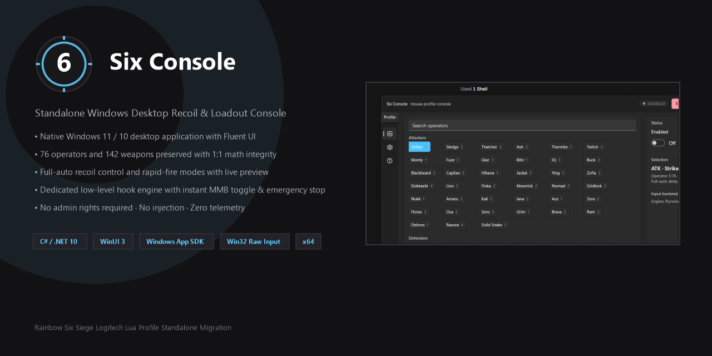
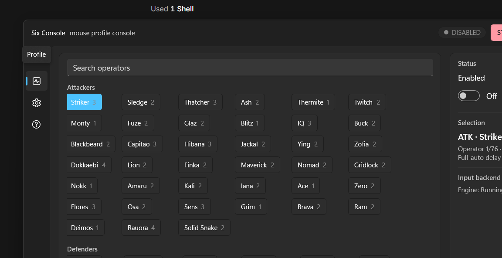
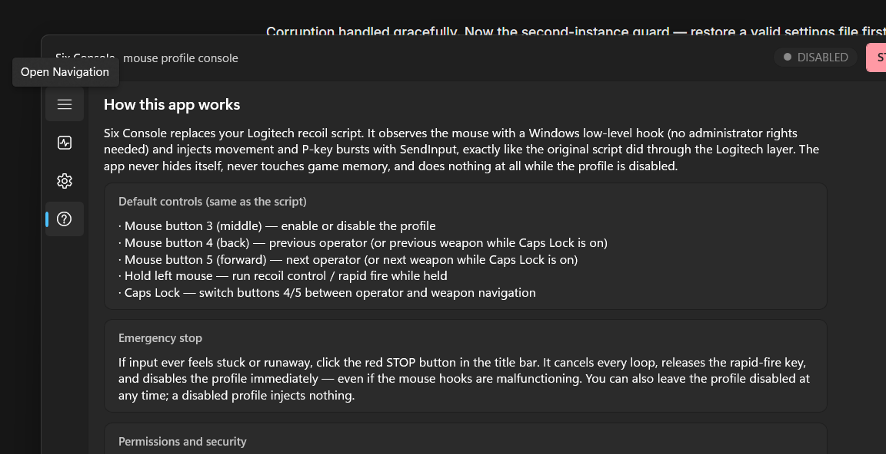
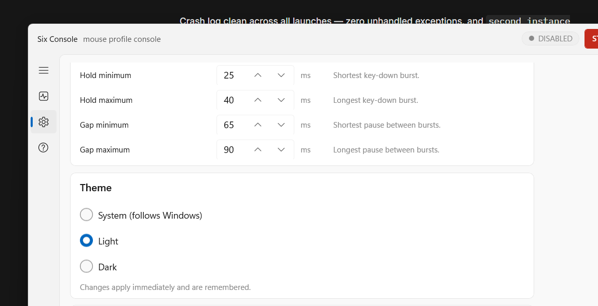
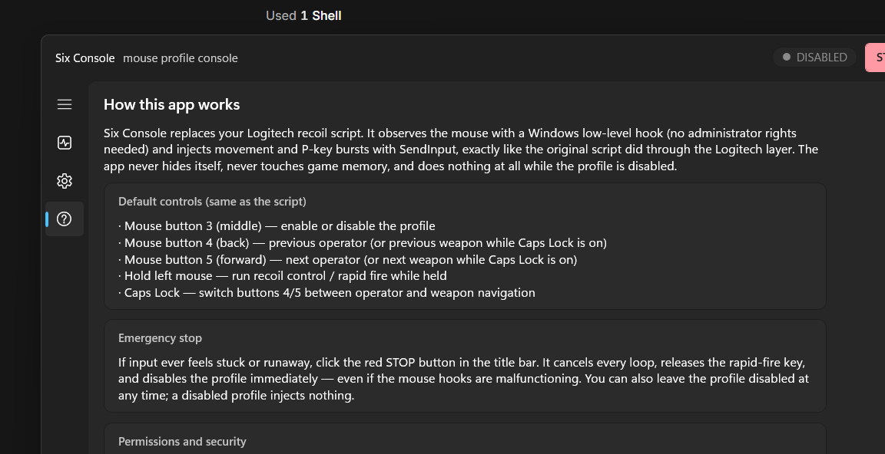

<p align="center">
  
</p>

<h1 align="center">Six Console</h1>

<p align="center">
  <strong>A standalone, native Windows 11/10 desktop utility for Rainbow Six Siege recoil control and rapid-fire management.</strong>
</p>

<p align="center">
  
  
  
  
  
  
</p>

<p align="center">
  
</p>

---

## Overview

**Six Console** is a native Windows desktop utility that liberates Logitech G HUB / LGS Lua recoil scripts into an independent, real Windows application.

Originally, running recoil and rapid-fire routines for tactical shooters like Rainbow Six Siege required vendor-locked mouse software (Logitech G HUB / Gaming Software) executing untracked Lua scripts in a terminal-like log window. **Six Console** provides a standalone desktop experience built with **WinUI 3**, **.NET 10**, and **Windows App SDK 1.8**, delivering a fluid, accessible, and disciplined user interface adhering strictly to Windows Fluent Design.

### Key Highlights
- **100% Source-Faithful Catalogue:** All 76 operators (Attacker and Defender) and 142 distinct weapon profiles are transcribed 1:1 into compiled JSON, verified against the canonical Lua source by automated regression tests.
- **Identical Mathematical Model:** Implements the exact Lua calculation `floor(pull * recoilMultiplier + 0.5)` with vertical variance and horizontal jitter simulation.
- **Hardware-Agnostic Input Adapter:** Uses documented Win32 low-level mouse hooks (`WH_MOUSE_LL`) and standard `SendInput` APIs—works with **any** mouse hardware, not just Logitech.
- **Safety First:** Distinguishable synthetic input (`LLMHF_INJECTED`), no process injection, no memory tampering, no anti-cheat evasion, zero telemetry, and an always-available **Emergency STOP** control.

---

## Screenshots

<table align="center">
  <tr>
    <td align="center"><strong>Profile & Loadout View (Dark Theme)</strong></td>
    <td align="center"><strong>Roster Selection (Light Theme)</strong></td>
  </tr>
  <tr>
    <td></td>
    <td></td>
  </tr>
  <tr>
    <td align="center"><strong>Settings & Calibration (Light Theme)</strong></td>
    <td align="center"><strong>Diagnostics & Help (Dark Theme)</strong></td>
  </tr>
  <tr>
    <td></td>
    <td></td>
  </tr>
</table>

---

## Features

- **Attacker & Defender Rosters:** Filterable tile view displaying every operator and their weapon count. Instant, responsive selection with search filtering.
- **Per-Weapon Loadouts:** View and select primary and secondary weapons. Shows firing mode, effective vertical pull (in pixels), and timing windows.
- **Dual Firing Modes:**
  - **Full-Auto Recoil Control:** Injects calculated vertical compensation and jitter while holding Left Mouse Button.
  - **Rapid-Fire Mode:** Emits secondary key bursts (`rfKey`, default `'P'`) with configurable hold and gap intervals for semi-automatic and DMR weapons.
- **Real-Time Telemetry:** Live status panel, title bar indicator, and status bar displaying active operator, weapon loadout, mode, effective pull, Caps Lock state, and input hook health.
- **Comprehensive Settings:**
  - Global sensitivity / recoil multiplier (default: `0.9×`).
  - Vertical variance (default: `±1 px`) and horizontal jitter (default: `±1 px`).
  - Full-auto delay minimum/maximum (default: `2–5 ms`).
  - Rapid-fire key (default: `'P'`), hold duration (`25–40 ms`), and gap duration (`65–90 ms`).
  - Atomic persistence to local JSON with instant validation and a one-click "Restore Defaults" dialog.
- **Fluent Theme Engine:** Instant switching between **System** (follows Windows preference), **Light**, and **Dark** themes.
- **Emergency Stop:** Titlebar `STOP` button and engine cancellation guarantee all loops immediately terminate and held keys are released.

---

## Default Controls & Navigation

The default bindings faithfully mirror the original script's ergonomic workflow:

| Control | Action | Details |
|---|---|---|
| **Mouse Button 3 (Middle Click)** | **Toggle Profile ON / OFF** | Physical mouse wheel click toggles the engine reliably in both directions. |
| **Mouse Button 5 (Forward)** | **Next Operator / Weapon** | Advance to next operator (resets weapon to 1). While **Caps Lock is ON**, advances to next weapon for current operator. |
| **Mouse Button 4 (Back)** | **Previous Operator / Weapon** | Go to previous operator (resets weapon to 1). While **Caps Lock is ON**, goes to previous weapon for current operator. |
| **Hold Left Mouse Button** | **Execute Recoil / Rapid Fire** | Applies recoil pull and/or rapid-fire bursts while held; stops immediately on release. |
| **Caps Lock** | **Modifier Switch** | Switches MB4 and MB5 between Operator navigation and Weapon navigation. |
| **F10** *(Configurable)* | **Toggle Profile Active** | In-app keyboard shortcut to toggle active profile status. |
| **Ctrl + 1 / 2 / 3** *(Configurable)* | **Direct View Navigation** | Switch views directly: Profile (`Ctrl+1`), Settings (`Ctrl+2`), Help (`Ctrl+3`). |
| **Ctrl + Up / Down** *(Configurable)* | **Cycle Operators** | Navigate to previous or next operator. |
| **Ctrl + Left / Right** *(Configurable)* | **Cycle Weapons** | Navigate to previous or next weapon. |
| **Titlebar STOP Button** | **Emergency Stop** | Immediately cancels all background worker loops, releases held keys, and disables the profile. |

---

## Supported Platforms & System Requirements

### Supported Operating Systems
- **Windows 11 x64** (Build 22000 or higher) — *Fully verified on Windows 11 Pro x64 (Build 26200).*
- **Windows 10 x64** (Build 19041 or higher) — *Supported compilation floor.*
- *Linux / macOS are explicitly out of scope.*

### Prerequisites
- **End Users:** Windows App Runtime 1.8+ (automatically provided in self-contained releases).
- **Developers:** [.NET 10.0 SDK](https://dotnet.microsoft.com/download) (version 10.0.300+).
- **Privileges:** **Standard User**. No administrator rights required.

---

## Installation & Quick Start

### Option 1: Standalone Portable (Recommended)
1. Download the latest `SixConsole-v1.0.0-win-x64.zip` from [Releases](https://github.com/hmdamm/SixConsole/releases).
2. Extract the archive into any folder (e.g., `C:\Tools\SixConsole`).
3. Run `SixConsole.App.exe`. No installation, MSIX registration, or admin rights required.

### Option 2: Build From Source
Clone the repository and build the project using the .NET SDK:

```powershell
# Clone the repository
git clone https://github.com/hmdamm/SixConsole.git
cd SixConsole

# Run the test suite to verify data and platform integrity (83 tests)
dotnet test src/SixConsole.Tests

# Build the application
dotnet build src/SixConsole.App/SixConsole.App.csproj -c Debug

# Launch the application
& src/SixConsole.App/bin/Debug/net10.0-windows10.0.26100.0/win-x64/SixConsole.App.exe
```

### Self-Contained Release Packaging
To build an independent, self-contained release package:

```powershell
dotnet publish src/SixConsole.App/SixConsole.App.csproj `
  -c Release `
  -r win-x64 `
  --self-contained true `
  -p:WindowsAppSDKSelfContained=true

# Output directory:
# src/SixConsole.App/bin/Release/net10.0-windows10.0.26100.0/win-x64/publish/
```

---

## Configuration & Local Storage

Six Console stores all user configuration locally without any cloud dependencies or telemetry:

- **Settings File:** `%LOCALAPPDATA%\SixConsole\settings.json`  
  Stores your custom multiplier, variance, delay, keybindings, theme, and last selected operator.
- **Diagnostic Log:** `%LOCALAPPDATA%\SixConsole\log.txt`  
  Stores local operational entries and hook states (accessible directly from the Help page).

> [!TIP]
> Deleting the `%LOCALAPPDATA%\SixConsole` folder completely resets the application to original factory script defaults.

---

## Architecture

Six Console is architected with strict separation of concerns:

```
┌────────────────────────────────────────────────────────┐
│ UI Layer (WinUI 3 / XAML)                              │
│   ProfileView · SettingsView · HelpView · StatusBarView│
│   ViewModels (CommunityToolkit MVVM)                   │
├────────────────────────────────────────────────────────┤
│ Application Services & Controller                      │
│   ProfileController · AppServices · SettingsStore      │
├────────────────────────────────────────────────────────┤
│ Domain Layer (SixConsole.Profile)                      │
│   Operator/Weapon Schema · Catalogue (operators.json)  │
│   PullCalculation · SelectionModel · ProfileSettings   │
├───────────────────┬────────────────────────────────────┤
│ Input Engine      │ Win32 Platform Adapter             │
│   Dedicated Hook  │   WH_MOUSE_LL Low-Level Hook       │
│   Message Pump    │   SendInput (LLMHF_INJECTED filter)│
│   Worker Loops    │   GetKeyState(VK_CAPITAL)          │
└───────────────────┴────────────────────────────────────┘
```

1. **`SixConsole.Profile`**: Domain library with zero UI or OS dependencies. Owns roster schemas, JSON deserialization, mathematical calculation, and list wraparound rules.
2. **`SixConsole.App`**: Presentation and engine implementation. Low-level hook runs on a dedicated background thread with its own Win32 message pump. The UI thread communicates with the engine exclusively through marshaled snapshots.
3. **`SixConsole.Tests`**: Automated test suite asserting 1:1 parity with the canonical Lua fixture, persistence round-trips, validation rules, and synthetic event layouts.

---

## Automated Testing

Six Console includes an exhaustive automated test suite with **59 passing tests**:

```powershell
dotnet test src/SixConsole.Tests --verbosity normal
```

Test coverage includes:
- **Source Integrity (`SourceIntegrityTests`):** Regex-parses the canonical Lua script fixture and asserts 1:1 matching operator names, sides, weapon counts, pull values, and rapid-fire flags.
- **Mathematical Fidelity (`DefaultsAndCalculationTests`):** Validates the exact rounding formula `floor(pull * multiplier + 0.5)` against source test vectors.
- **Navigation Logic (`SelectionNavigationTests`):** Exercises wraparound navigation across operators and weapons under Caps Lock.
- **Input Engine (`InputEngineLoopTests`):** Tests full-auto recoil movement injection, rapid-fire key burst sequences, zero-gap boundary limits, emergency stops, and middle mouse button toggles without touching physical desktop input.
- **Persistence (`SettingsPersistenceTests`):** Validates atomic JSON round-trips, corrupted file fallbacks, out-of-range clamps, and unapplied draft discards.
- **ABI Layouts (`Win32SendInputLayoutTests`):** Verifies 64-bit memory layout and struct sizes for `INPUT`, `KEYBDINPUT`, and `MOUSEINPUT` unions.

---

## Troubleshooting & FAQ

#### Why do my buttons not trigger anything in-game?
1. Ensure the profile is **ACTIVE** (status indicator green). Press Middle Mouse Button or toggle the switch in the UI.
2. Some games run under elevated permissions or use kernel-level anti-cheat drivers that discard synthetic `SendInput` events. Six Console intentionally does not bypass anti-cheat systems.

#### The profile feels runaway or stuck
Click the red **STOP** button in the top-right title bar. It cancels all active loops, releases the secondary key, and disables the profile immediately.

#### How do I restore default settings?
Open the **Settings** view and click **Restore source defaults…**, then confirm the dialog.

---

## Known Limitations

- **Platform Scope:** Windows 10/11 x64 only. macOS and Linux are out of scope.
- **Anti-Cheat:** The app relies on standard user-mode Windows input APIs (`SendInput`). If a game blocks synthetic input, Six Console will not attempt to bypass or evade it.
- **Catalogue Updates:** Operator and weapon statistics are derived from the canonical Lua profile. Updating entries requires running `tools/generate-catalogue.py`.

---

## License & Legal Notice

- **Licensing:** A formal open-source license decision remains with the project maintainer. Please refer to [CONTRIBUTING.md](CONTRIBUTING.md) for contribution guidelines.
- **Disclaimer:** *Rainbow Six Siege* is a registered trademark of Ubisoft Entertainment. Six Console is an independent utility created for mouse profile management and is not affiliated with, endorsed by, or associated with Ubisoft or Logitech.
